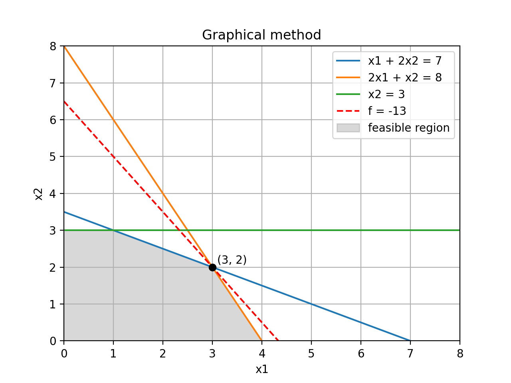

# Linear Programming: Graphical Method

Solves a linear programming problem graphically using Python (Lab 3, Variant 1).

## Problem

```
f(x) = -3*x1 - 2*x2 -> min/max

x1 + 2*x2 <= 7
2*x1 + x2 <= 8
x2 <= 3
x1, x2 >= 0
```

## Result

| | Value | Point |
|---|---|---|
| min | -13 | (3, 2) |
| max | 0 | (0, 0) |



## Run

```bash
pip install matplotlib
python lp_graphical.py
```
